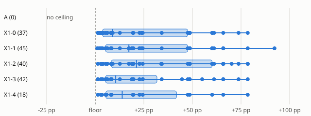

# X1 comparison tables (spec-idea-lab 6.5)

Sources (O44): more_itertools: X1-1's probe, idea and reply rows from x1-1-rerun.jsonl; every audit-based figure (share-new, self/cross, good counts, auditor-feasible) from ideas-reaudit-41772132719.jsonl; the rest from ideas-probe-x1-run1-41679255224.jsonl; pyparsing: X1-1's probe, idea and reply rows from x1-1-rerun.jsonl; every audit-based figure (share-new, self/cross, good counts, auditor-feasible) from ideas-reaudit-41772132719.jsonl; the rest from ideas-probe-x1-run1-41679255224.jsonl; tomli: X1-1's probe, idea and reply rows from x1-1-rerun.jsonl; every audit-based figure (share-new, self/cross, good counts, auditor-feasible) from ideas-reaudit-41772132719.jsonl; the rest from ideas-probe-x1-run1-41679255224.jsonl; sortedcontainers: X1-1's probe, idea and reply rows from x1-1-rerun.jsonl; every audit-based figure (share-new, self/cross, good counts, auditor-feasible) from ideas-reaudit-41772132719.jsonl; the rest from ideas-probe-x1-run1-41679255224.jsonl; mistune: ideas-probe-x1-run2a-41773968543.jsonl; sqlparse: ideas-probe-x1-run2a-41773968543.jsonl; markdown: ideas-probe-x1-run2a-41773968543.jsonl; idna: ideas-probe-x1-run2b-41780421911.jsonl; the reader dispatch (O48): ideas-picks-42096064178.jsonl

## 1 Mechanism x configuration overlap (upper bound, the dedupe under-merges (O39))

Each deduplicated mechanism (keyed ideas only) and how many ideas of each configuration it holds.

| library | mechanism | cell | target | X1-0 | X1-1 | X1-2 | X1-3 | X1-4 | unique to | raw titles |
| --- | --- | --- | --- | --- | --- | --- | --- | --- | --- | --- |
| idna | remove_work | algorithm\:better_constant | idna/intranges.py\:42-47 | 1 | 0 | 1 | 1 | 1 | - | Inline range decoding in intranges_contain to avoid two helper calls per codepoint; Inline range decode/encode in intranges_contain to drop helper calls; Inline range decoding in intranges_contain to… |
| idna | precompute_or_cache | memory\:cache_across_calls | idna/core.py\:482-483 | 1 | 1 | 1 | 1 | 1 | - | Hoist codepoint_classes lookups and cache per-codepoint PVALID results in check_label; Cache PVALID/CONTEXTJ/CONTEXTO tables in locals and add a per-codepoint PVALID memo in check_label; Cache PVALID… |
| idna | precompute_or_cache | work\:reuse | idna/core.py\:224-227 | 1 | 0 | 0 | 0 | 1 | - | Fuse bidi direction scan\: skip full check for labels with only LTR characters; Skip unicodedata.bidirectional second pass for LTR-only labels in check_bidi |
| idna | specialised_fast_path | work\:eliminate | idna/core.py\:189-191 | 1 | 0 | 0 | 0 | 0 | only X1-0 | Skip ASCII-only labels in check_bidi by using str.isascii and a precomputed ASCII path |
| idna | precompute_or_cache | memory\:cache_across_calls | idna/core.py\:684-684 | 1 | 0 | 0 | 0 | 0 | only X1-0 | Replace bisect-based uts46 lookup for BMP with a lazily built per-codepoint dict cache |
| idna | precompute_or_cache | work\:reuse | idna/core.py\:605-608 | 1 | 0 | 0 | 0 | 0 | only X1-0 | Seed a reverse A-label to U-label cache in alabel so ulabel skips punycode decode, re-encode and check_label |
| idna | remove_work | work\:eliminate | idna/intranges.py\:42-47 | 0 | 1 | 0 | 0 | 0 | only X1-1 | Inline range decode and encode in intranges_contain to drop helper calls |
| idna | remove_work | work\:reuse | idna/core.py\:224-227 | 0 | 1 | 0 | 0 | 0 | only X1-1 | Single-pass bidi direction scan in check_bidi with cached direction list |
| idna | precompute_or_cache | memory\:cache_across_calls | idna/core.py\:605-608 | 0 | 1 | 1 | 0 | 0 | - | Memoize successful check_label results across calls so decode does not revalidate labels encode already validated; Fast path in ulabel\: skip the redundant re-encode via a cache of alabel results |
| idna | specialised_fast_path | work\:eliminate | idna/core.py\:476-478 | 0 | 1 | 0 | 0 | 0 | only X1-1 | ASCII fast path in check_label\: lowercase letters/digits/hyphen skip NFC, combiner, per-codepoint and bidi checks |
| idna | precompute_or_cache | representation\:indexed | idna/core.py\:682-685 | 0 | 1 | 0 | 0 | 0 | only X1-1 | Replace uts46_remap's per-character bisect with a dense status array indexed by codepoint |
| idna | precompute_or_cache | work\:reuse | idna/core.py\:190-192 | 0 | 0 | 1 | 0 | 0 | only X1-2 | Fuse the two bidi passes and cache bidirectional class lookups in check_bidi |
| idna | remove_work | work\:eliminate | idna/core.py\:544-545 | 0 | 0 | 1 | 0 | 0 | only X1-2 | Skip the ASCII re-encode and re-check in alabel by running check_label directly on the ASCII str |
| idna | representation | representation\:specialised_type | idna/core.py\:480-483 | 0 | 0 | 1 | 0 | 0 | only X1-2 | Validate whole label at C speed with a lazily compiled PVALID character-class regex in check_label |
| idna | loop_or_control_flow | granularity\:fuse | idna/core.py\:190-192 | 0 | 0 | 0 | 1 | 0 | only X1-3 | Fuse check_bidi's two bidirectional passes into one by caching per-label direction list |
| idna | precompute_or_cache | memory\:cache_across_calls | idna/intranges.py\:42-43 | 0 | 0 | 0 | 1 | 0 | only X1-3 | Memoise intranges_contain results per (codepoint, table) with a dict cache |
| markdown | precompute_or_cache | timing\:precompute | markdown/treeprocessors.py\:134-137 | 1 | 1 | 0 | 0 | 0 | - | Hoist inline pattern registry lookup out of the per-pattern loop in __handleInline; Skip Registry sort check by snapshotting inline patterns once per InlineProcessor.run |
| markdown | remove_work | work\:eliminate | markdown/treeprocessors.py\:276-278 | 1 | 1 | 0 | 1 | 0 | - | Avoid per-call lower() and tag work in __applyPattern for ancestor excludes; Avoid per-call list copies and lowercasing in __applyPattern ancestor-exclusion check; Skip ancestor-exclude scan in __app… |
| markdown | data_structure | algorithm\:better_constant | markdown/treeprocessors.py\:376-376 | 1 | 1 | 1 | 0 | 1 | - | Replace stack.pop(0) with a deque and drop per-element list copies in InlineProcessor.run; Use collections.deque or index pointer for the work stack in InlineProcessor.run; Replace stack.pop(0) with … |
| markdown | remove_work | work\:eliminate | markdown/extensions/abbr.py\:118-120 | 1 | 0 | 0 | 0 | 1 | - | Skip abbr regex scanning and list copies in AbbrTreeprocessor.iter_element when no match exists; Skip the abbr regex and list() copies for elements without text in AbbrTreeprocessor.iter_element |
| markdown | remove_work | work\:eliminate | markdown/treeprocessors.py\:136-140 | 1 | 0 | 0 | 0 | 0 | only X1-0 | Skip quick no-match patterns in __handleInline using cheap substring prefilter |
| markdown | remove_work | work\:defer | markdown/treeprocessors.py\:404-406 | 1 | 0 | 1 | 0 | 0 | - | Replace list(node).index(child) lookups in InlineProcessor.run tail handling with an enumerated position; Skip per-child list(currElement).index scan for tails in InlineProcessor.run |
| markdown | precompute_or_cache | timing\:precompute | markdown/util.py\:341-343 | 1 | 0 | 0 | 0 | 0 | only X1-0 | Cache sorted pattern list in Registry so __getitem__ skips _sort and isinstance checks on int keys |
| markdown | remove_work | work\:defer | markdown/extensions/abbr.py\:119-121 | 0 | 1 | 1 | 1 | 0 | - | Make abbr iter_element avoid list(parent).index and run regex only when text could match; Abbr iter_element\: avoid list(parent).index and skip regex on text-less nodes; Abbr treeprocessor\: compute th… |
| markdown | specialised_fast_path | work\:eliminate | markdown/treeprocessors.py\:404-405 | 0 | 1 | 0 | 0 | 0 | only X1-1 | Skip the tail-index search in InlineProcessor.run when no tail placeholders were created |
| markdown | remove_work | work\:eliminate | markdown/treeprocessors.py\:379-379 | 0 | 1 | 0 | 0 | 0 | only X1-1 | Drop the per-node parent_map walk in InlineProcessor.run by carrying the ancestor chain down the work stack |
| markdown | data_structure | timing\:precompute | markdown/util.py\:341-343 | 0 | 1 | 0 | 0 | 0 | only X1-1 | Registry keeps a materialised sorted item list so __getitem__ by index and __iter__ are a single list access |
| markdown | remove_work | work\:reuse | markdown/serializers.py\:162-164 | 0 | 1 | 0 | 0 | 0 | only X1-1 | Cache lowercased tag names to avoid repeated str.lower in ancestors building and serializer |
| markdown | specialised_fast_path | algorithm\:approximate_then_verify | markdown/treeprocessors.py\:135-140 | 0 | 1 | 0 | 0 | 0 | only X1-1 | Trigger-character prefilter in __handleInline\: skip inline patterns whose required literal char is absent from the text |
| markdown | precompute_or_cache | work\:eliminate | markdown/treeprocessors.py\:135-138 | 0 | 0 | 1 | 1 | 0 | - | Skip sorted-check overhead in Registry.__getitem__ for int keys via fast path; Hoist inline pattern registry lookups out of the per-call loop in __handleInline |
| markdown | precompute_or_cache | work\:reuse | markdown/treeprocessors.py\:274-277 | 0 | 0 | 1 | 0 | 0 | only X1-2 | Cache per-pattern compiled regex and ancestor-exclude checks in __applyPattern |
| markdown | remove_work | work\:eliminate | markdown/treeprocessors.py\:310-312 | 0 | 0 | 1 | 0 | 0 | only X1-2 | Skip child/tail reprocessing loops in __applyPattern for nodes with no children, text or tail |
| markdown | specialised_fast_path | work\:eliminate | markdown/treeprocessors.py\:210-212 | 0 | 0 | 1 | 0 | 0 | only X1-2 | Skip placeholder scanning for text that contains no placeholder prefix in __processPlaceholders |
| markdown | specialised_fast_path | algorithm\:better_constant | markdown/util.py\:335-336 | 0 | 0 | 0 | 1 | 0 | only X1-3 | Skip Registry._sort check cost in __getitem__ by fast-pathing int keys on a sorted registry |
| markdown | precompute_or_cache | work\:reuse | markdown/treeprocessors.py\:136-138 | 0 | 0 | 0 | 0 | 1 | only X1-4 | Hoist inline pattern list lookup out of the __handleInline loop in InlineProcessor |
| mistune | algorithm | algorithm\:better_constant | src/mistune/_inline/links.py\:240-244 | 1 | 1 | 1 | 1 | 0 | - | Rewrite build_closing_bracket_map as a regex-driven scan over bracket and backslash characters only; Replace per-char Python loop in build_closing_bracket_map with regex-driven scan; Replace char-by-… |
| mistune | specialised_fast_path | work\:eliminate | src/mistune/_inline/emphasis.py\:196-198 | 1 | 1 | 0 | 0 | 0 | - | Skip _split_text_token character scanning for text tokens without emphasis markers; Fast-path _split_text_token for text tokens without emphasis markers |
| mistune | precompute_or_cache | memory\:cache_across_calls | src/mistune/inline_parser.py\:281-282 | 1 | 0 | 0 | 0 | 0 | only X1-0 | Cache the compiled fast-trigger regex lookup in InlineParser._find_fast_text_end |
| mistune | loop_or_control_flow | granularity\:fuse | src/mistune/inline_parser.py\:281-284 | 1 | 0 | 0 | 0 | 0 | only X1-0 | Fuse fast-trigger search into InlineParser.parse by caching the compiled trigger regex locally |
| mistune | algorithm | algorithm\:better_constant | src/mistune/_inline/emphasis.py\:217-220 | 0 | 1 | 0 | 1 | 0 | - | Use regex to split text tokens in emphasis _split_text_token and drop char-wise scanning; Skip delimiter splitting loops using regex in emphasis _split_text_token |
| mistune | precompute_or_cache | memory\:cache_across_calls | src/mistune/renderers/html.py\:42-43 | 0 | 1 | 1 | 0 | 0 | - | Cache bound renderer methods and skip _get_method indirection in HTMLRenderer.render_token; Cache bound renderer methods in render_token to avoid _get_method overhead |
| mistune | remove_work | work\:eliminate | src/mistune/inline_parser.py\:281-284 | 0 | 1 | 0 | 0 | 0 | only X1-1 | Hoist loop invariants and use bound regex in InlineParser.parse fast path |
| mistune | specialised_fast_path | algorithm\:better_constant | src/mistune/helpers.py\:155-160 | 0 | 1 | 1 | 0 | 0 | - | Regex fast path for plain link destinations in helpers._parse_link_href, falling back to the char loop; Fast-path _parse_link_href with a regex for plain href runs |
| mistune | algorithm | algorithm\:lower_complexity | src/mistune/_inline/emphasis.py\:238-241 | 0 | 1 | 0 | 0 | 0 | only X1-1 | Replace backward opener scan in _process_emphasis_delimiters with per-key opener stacks |
| mistune | allocation_or_copying | granularity\:batch | src/mistune/renderers/html.py\:47-48 | 0 | 1 | 0 | 0 | 0 | only X1-1 | Join token renders from a list comprehension instead of a generator in BaseRenderer.render_tokens |
| mistune | lazy_or_streaming | timing\:lazy | src/mistune/_inline/links.py\:245-250 | 0 | 1 | 0 | 0 | 0 | only X1-1 | Evaluate nested-link check on demand over openers inside the label, not via a whole-source range index |
| mistune | specialised_fast_path | algorithm\:better_constant | src/mistune/_inline/emphasis.py\:218-220 | 0 | 0 | 1 | 0 | 0 | only X1-2 | Skip emphasis splitting char scans using regex finditer in _split_text_token and _next_delimiter_run |
| mistune | precompute_or_cache | timing\:precompute | src/mistune/inline_parser.py\:281-282 | 0 | 0 | 1 | 1 | 0 | - | Avoid re-sorting trigger chars and re-checking regex per call in InlineParser._find_fast_text_end; Cache the fast trigger regex in InlineParser to avoid per-call sorting |
| mistune | remove_work | work\:eliminate | src/mistune/_inline/emphasis.py\:228-230 | 0 | 0 | 1 | 0 | 0 | only X1-2 | Avoid per-token source string build when no emphasis delimiter can be opened or closed |
| mistune | loop_or_control_flow | granularity\:fuse | src/mistune/_inline/emphasis.py\:208-209 | 0 | 0 | 1 | 0 | 0 | only X1-2 | Fuse _can_open/_can_close emphasis checks into one neighbour computation per delimiter run |
| mistune | precompute_or_cache | memory\:cache_across_calls | src/mistune/core.py\:258-260 | 0 | 0 | 0 | 1 | 1 | - | Cache bound renderer methods per token type in render_token; Cache bound renderer methods in HTMLRenderer.render_token and skip _get_method try/except |
| mistune | algorithm | algorithm\:better_constant | src/mistune/helpers.py\:158-161 | 0 | 0 | 0 | 1 | 0 | only X1-3 | Fast path for common link hrefs in _parse_link_href using a compiled regex |
| mistune | specialised_fast_path | work\:eliminate | src/mistune/inline_parser.py\:229-232 | 0 | 0 | 0 | 1 | 0 | only X1-3 | Skip per-call compile_sc lookup and finalize work for pure-text inline strings |
| mistune | specialised_fast_path | work\:eliminate | src/mistune/inline_parser.py\:217-219 | 0 | 0 | 0 | 1 | 0 | only X1-3 | Buffer text pieces in process_text and join once per text token |
| mistune | remove_work | work\:eliminate | src/mistune/_inline/links.py\:245-248 | 0 | 0 | 0 | 1 | 0 | only X1-3 | Skip link-range index building in label_contains_link when the link label holds no '\[' character |
| mistune | loop_or_control_flow | algorithm\:better_constant | src/mistune/_inline/links.py\:240-245 | 0 | 0 | 0 | 0 | 1 | only X1-4 | Replace char-by-char bracket scan in build_closing_bracket_map with regex-driven jumps |
| mistune | loop_or_control_flow | algorithm\:better_constant | src/mistune/_inline/emphasis.py\:218-220 | 0 | 0 | 0 | 0 | 1 | only X1-4 | Use regex to split text tokens in _split_text_token and _next_delimiter_run |
| mistune | loop_or_control_flow | algorithm\:better_constant | src/mistune/helpers.py\:158-162 | 0 | 0 | 0 | 0 | 1 | only X1-4 | Speed up _parse_link_href scanning with a regex for plain destination characters |
| mistune | precompute_or_cache | work\:reuse | src/mistune/inline_parser.py\:291-292 | 0 | 0 | 0 | 0 | 1 | only X1-4 | Hoist per-call lookups in InlineParser.parse and _find_fast_text_end |
| more_itertools | allocation_or_copying | memory\:reuse_buffers | more_itertools/recipes.py\:1468-1472 | 1 | 0 | 1 | 0 | 0 | - | Avoid tuple allocation and index arithmetic in _windowed_running_min deque; Cache locals and avoid tuple indexing in _windowed_running_min/max |
| more_itertools | allocation_or_copying | memory\:reuse_buffers | more_itertools/recipes.py\:1509-1513 | 1 | 0 | 0 | 0 | 0 | only X1-0 | Same parallel-deque optimization for _windowed_running_max |
| more_itertools | loop_or_control_flow | algorithm\:better_constant | more_itertools/recipes.py\:1425-1429 | 1 | 0 | 0 | 0 | 0 | only X1-0 | Speed up _windowed_running_mean by hoisting method lookups and avoiding len() calls |
| more_itertools | specialised_fast_path | algorithm\:better_constant | more_itertools/more.py\:1433-1436 | 1 | 0 | 0 | 1 | 0 | - | Optimize collapse inner loop\: cache isinstance tuple and bound methods; collapse\: fast path for non-iterable scalars and local bindings |
| more_itertools | algorithm | algorithm\:better_constant | more_itertools/recipes.py\:1373-1377 | 1 | 0 | 0 | 0 | 0 | only X1-0 | Median window\: skip the insort-then-delete step by using bisect-based replace when the window is full |
| more_itertools | loop_or_control_flow | work\:eliminate | more_itertools/more.py\:1198-1201 | 1 | 0 | 0 | 1 | 0 | - | bucket._get_values\: bind cache deque and key lookup once per generator, avoid repeated dict lookup; bucket._get_values\: bind cache deque and hoist attribute lookups |
| more_itertools | loop_or_control_flow | work\:eliminate | more_itertools/recipes.py\:1372-1377 | 1 | 1 | 1 | 0 | 0 | - | Running median window\: avoid second bisect by tracking via sorted insertion index; Phase-split _running_median_windowed\: fill phase, then fixed-size steady loop with precomputed parity and ring buffe… |
| more_itertools | remove_work | work\:eliminate | more_itertools/more.py\:1198-1199 | 0 | 1 | 1 | 0 | 1 | - | Hoist attribute lookups and local bindings in bucket._get_values; Hoist attribute lookups in bucket._get_values into locals; Hoist attribute lookups and use local cache bindings in bucket._get_values |
| more_itertools | allocation_or_copying | algorithm\:better_constant | more_itertools/recipes.py\:1468-1471 | 0 | 1 | 0 | 1 | 0 | - | Avoid tuple allocation and repeated indexing in windowed running min/max; Windowed running min/max\: store parallel index and value deques, avoid tuple allocation |
| more_itertools | specialised_fast_path | algorithm\:better_constant | more_itertools/recipes.py\:1425-1429 | 0 | 1 | 0 | 0 | 0 | only X1-1 | Cache bound methods and drop len calls in windowed running mean |
| more_itertools | specialised_fast_path | work\:eliminate | more_itertools/more.py\:1433-1436 | 0 | 1 | 0 | 0 | 1 | - | Fast path for non-iterable ints in collapse using a type check; Fast path in collapse for leaf nodes without isinstance tuple checks per item |
| more_itertools | loop_or_control_flow | algorithm\:better_constant | more_itertools/recipes.py\:1372-1376 | 0 | 1 | 0 | 0 | 0 | only X1-1 | Use bound locals and fewer lookups in windowed running median |
| more_itertools | data_structure | representation\:compact | more_itertools/more.py\:1418-1423 | 0 | 1 | 0 | 0 | 0 | only X1-1 | Replace collapse's deque stack with a plain list stack in more.py |
| more_itertools | loop_or_control_flow | algorithm\:better_constant | more_itertools/more.py\:1203-1208 | 0 | 1 | 0 | 0 | 0 | only X1-1 | Replace try/next loop with a resumable for-loop over the parent iterator in bucket._get_values |
| more_itertools | algorithm | granularity\:batch | more_itertools/recipes.py\:1470-1472 | 0 | 1 | 0 | 0 | 0 | only X1-1 | Block-based (van Herk) sliding min/max via C-level accumulate/map instead of per-item deque loop |
| more_itertools | loop_or_control_flow | granularity\:fuse | more_itertools/recipes.py\:1425-1429 | 0 | 1 | 0 | 0 | 0 | only X1-1 | Windowed running mean\: use accumulate-difference pipeline instead of per-item generator with deque |
| more_itertools | loop_or_control_flow | work\:eliminate | more_itertools/recipes.py\:1425-1429 | 0 | 0 | 1 | 1 | 1 | - | Speed up _windowed_running_mean with local bindings and a tracked length; Windowed running mean\: avoid len(window) calls by tracking the count and using local method bindings; Cheaper windowed runnin… |
| more_itertools | remove_work | work\:eliminate | more_itertools/more.py\:1433-1435 | 0 | 0 | 1 | 0 | 0 | only X1-2 | Fast path in collapse for the common non-iterable, non-str items |
| more_itertools | data_structure | representation\:compact | more_itertools/recipes.py\:1372-1377 | 0 | 0 | 1 | 0 | 0 | only X1-2 | Running median windowed\: avoid the deque by deriving the evicted value from the source with a ring list |
| more_itertools | representation | granularity\:fuse | more_itertools/recipes.py\:1424-1429 | 0 | 0 | 1 | 0 | 0 | only X1-2 | Rewrite _windowed_running_mean as a C-level pipeline\: interleave value and negated lagged value, accumulate with add |
| more_itertools | precompute_or_cache | work\:reuse | more_itertools/more.py\:1212-1213 | 0 | 0 | 0 | 1 | 0 | only X1-3 | bucket._get_values\: skip the validator call for already-cached keys by using a per-key seen set |
| more_itertools | remove_work | work\:eliminate | more_itertools/more.py\:3538-3541 | 0 | 0 | 0 | 1 | 0 | only X1-3 | set_partitions\: hoist the block-size filter lambda and skip it when size limits are trivial |
| more_itertools | specialised_fast_path | algorithm\:better_constant | more_itertools/recipes.py\:1468-1471 | 0 | 0 | 0 | 1 | 0 | only X1-3 | Windowed running min/max\: skip enumerate and tuple storage by using a monotonic deque with a countdown expiry |
| more_itertools | representation | representation\:compact | more_itertools/recipes.py\:1424-1429 | 0 | 0 | 0 | 1 | 0 | only X1-3 | Windowed running mean\: drop the deque by pairing the stream with a tee-lagged copy in a two-phase loop |
| more_itertools | allocation_or_copying | representation\:specialised_type | more_itertools/recipes.py\:1470-1472 | 0 | 0 | 0 | 0 | 1 | only X1-4 | Avoid tuple allocation and repeated indexing in _windowed_running_min/max via parallel deques |
| more_itertools | loop_or_control_flow | work\:eliminate | more_itertools/recipes.py\:1379-1381 | 0 | 0 | 0 | 0 | 1 | only X1-4 | Localise method lookups in _running_median_windowed |
| pyparsing | specialised_fast_path | work\:eliminate | pyparsing/core.py\:902-905 | 1 | 0 | 0 | 1 | 0 | - | Skip whitespace scan fast path in ParserElement.preParse; Skip whitespace with a precompiled regex or lstrip-style scan in preParse |
| pyparsing | allocation_or_copying | work\:eliminate | pyparsing/helpers.py\:1196-1196 | 1 | 0 | 0 | 0 | 0 | only X1-0 | Avoid redundant second parse of base_expr lookahead and as_list conversions in infix operator handling |
| pyparsing | remove_work | work\:eliminate | pyparsing/results.py\:214-216 | 1 | 0 | 0 | 0 | 1 | - | Hoist per-call ParseResults construction checks\: bypass __init__ kwargs deprecation lookup; Skip ParseResults construction work for unnamed results in _parseNoCache fast path |
| pyparsing | loop_or_control_flow | work\:eliminate | pyparsing/core.py\:925-929 | 1 | 0 | 0 | 0 | 0 | only X1-0 | Cache the whitespace-set emptiness check\: skip preParse call when nothing can be skipped in _parseNoCache |
| pyparsing | remove_work | work\:eliminate | pyparsing/helpers.py\:1317-1320 | 0 | 1 | 0 | 1 | 0 | - | Hoist _check_operand_follows closure out of the infix parse loop in _InfixNotation.parseImpl; Hoist closures and per-iteration state out of _InfixNotation.parseImpl main loop |
| pyparsing | specialised_fast_path | work\:eliminate | pyparsing/helpers.py\:1195-1195 | 0 | 1 | 0 | 0 | 0 | only X1-1 | Skip infix operator attempts whose first character cannot match, in _InfixNotation.parseImpl |
| pyparsing | loop_or_control_flow | algorithm\:better_constant | pyparsing/core.py\:901-905 | 0 | 1 | 0 | 0 | 0 | only X1-1 | Replace char-by-char whitespace skipping in ParserElement.preParse with a precompiled character-class regex |
| pyparsing | specialised_fast_path | algorithm\:better_constant | pyparsing/results.py\:214-216 | 0 | 1 | 0 | 0 | 0 | only X1-1 | ParseResults construction fast path\: skip deprecate_argument when no kwargs and use exact-type list check in __new__ |
| pyparsing | specialised_fast_path | algorithm\:better_constant | pyparsing/core.py\:964-967 | 0 | 0 | 1 | 0 | 0 | only X1-2 | Skip ParseResults construction when parse action returns a fresh result in _parseNoCache fast path |
| pyparsing | specialised_fast_path | algorithm\:better_constant | pyparsing/core.py\:904-905 | 0 | 0 | 1 | 0 | 1 | - | Inline whitespace skipping in preParse using a precomputed flag and avoid redundant length lookups; Cache whitespace skip via a precomputed fast check in preParse |
| pyparsing | specialised_fast_path | work\:eliminate | pyparsing/results.py\:214-216 | 0 | 0 | 1 | 1 | 0 | - | Lighter ParseResults.__init__/__new__ for the unnamed-token case; Fast path in ParseResults.__init__ for unnamed results to skip deprecate_argument call |
| pyparsing | loop_or_control_flow | work\:eliminate | pyparsing/helpers.py\:1317-1318 | 0 | 0 | 1 | 0 | 1 | - | Hoist _check_operand_follows and reduce_operators closures out of the infix parse loop; Hoist _check_operand_follows and reduce_operators closure creation out of the parse loop |
| pyparsing | specialised_fast_path | algorithm\:better_constant | pyparsing/core.py\:5155-5156 | 0 | 0 | 1 | 0 | 0 | only X1-2 | Avoid cost in ParseElementEnhance.parseImpl by moving the except handling off the success path |
| pyparsing | remove_work | work\:eliminate | pyparsing/helpers.py\:1196-1196 | 0 | 0 | 1 | 0 | 0 | only X1-2 | Avoid redundant as_list() calls on ParseResults in infix operator token extraction |
| pyparsing | specialised_fast_path | work\:eliminate | pyparsing/helpers.py\:1346-1349 | 0 | 0 | 1 | 0 | 0 | only X1-2 | Skip exception-and-reduction scaffolding\: hoist per-iteration preParse try/except in infix loop to first-char dispatch |
| pyparsing | specialised_fast_path | work\:eliminate | pyparsing/helpers.py\:1185-1188 | 0 | 0 | 1 | 0 | 0 | only X1-2 | Cache whitespace-skip decision in infix parse loop\: avoid preParse call when next char is not whitespace |
| pyparsing | specialised_fast_path | work\:eliminate | pyparsing/core.py\:964-966 | 0 | 0 | 0 | 1 | 0 | only X1-3 | Skip ParseResults wrapping when parseImpl already returns a ParseResults and no results name is set |
| pyparsing | precompute_or_cache | timing\:precompute | pyparsing/core.py\:4872-4875 | 0 | 0 | 0 | 1 | 0 | only X1-3 | MatchFirst.parseImpl\: avoid exception-object bookkeeping with locals and first-element fast path |
| pyparsing | allocation_or_copying | work\:defer | pyparsing/results.py\:188-191 | 0 | 0 | 0 | 1 | 0 | only X1-3 | Avoid ParseResults allocation of throwaway list/set in __new__ via lazily created _all_names |
| pyparsing | specialised_fast_path | algorithm\:approximate_then_verify | pyparsing/helpers.py\:1345-1349 | 0 | 0 | 0 | 1 | 0 | only X1-3 | Pre-check operator/paren candidates in _InfixNotation.parseImpl with the element's own matcher before calling _parse |
| pyparsing | specialised_fast_path | algorithm\:better_constant | pyparsing/results.py\:192-197 | 0 | 0 | 0 | 0 | 1 | only X1-4 | Fast path in ParseResults.__new__ by reordering type checks |
| sortedcontainers | remove_work | work\:eliminate | sortedcontainers/sortedlist.py\:279-283 | 1 | 1 | 1 | 1 | 1 | - | Inline _expand fast path into SortedList.add; Inline the non-split index update from _expand into SortedList.add; Inline _expand's common no-split path into SortedList.add; Inline _expand fast path i… |
| sortedcontainers | remove_work | work\:eliminate | sortedcontainers/sortedlist.py\:1811-1815 | 1 | 1 | 1 | 0 | 1 | - | Inline _expand fast path into SortedKeyList.add; Inline the non-split path of _expand into SortedKeyList.add; Inline _expand's no-split path into SortedKeyList.add |
| sortedcontainers | specialised_fast_path | algorithm\:better_constant | sortedcontainers/sorteddict.py\:298-300 | 1 | 0 | 1 | 1 | 1 | - | SortedDict.__setitem__\: skip redundant membership overhead; SortedDict.__setitem__\: use dict.__contains__ and skip the redundant lookup; SortedDict.__setitem__\: single dict insertion path avoiding do… |
| sortedcontainers | loop_or_control_flow | algorithm\:better_constant | sortedcontainers/sortedlist.py\:493-498 | 1 | 0 | 0 | 0 | 0 | only X1-0 | SortedList._delete\: replace leaf-to-root index decrement loop with a combined walk using cached locals |
| sortedcontainers | specialised_fast_path | work\:eliminate | sortedcontainers/sortedlist.py\:1933-1939 | 1 | 0 | 0 | 0 | 0 | only X1-0 | SortedKeyList.discard\: drop per-step re-lookups and skip scan loop for exact first match |
| sortedcontainers | data_structure | representation\:indexed | sortedcontainers/sortedlist.py\:315-320 | 1 | 1 | 0 | 0 | 0 | - | Replace heap-shaped positional tree with a two-level block-count index so add/delete touch one counter; Replace the positional tree index with a lazily repaired flat prefix-sum array plus a dirty wat… |
| sortedcontainers | remove_work | work\:eliminate | sortedcontainers/sorteddict.py\:298-300 | 0 | 1 | 0 | 0 | 0 | only X1-1 | SortedDict.__setitem__\: single dict insert via len check instead of the membership test |
| sortedcontainers | loop_or_control_flow | granularity\:fuse | sortedcontainers/sortedlist.py\:684-688 | 0 | 1 | 0 | 0 | 0 | only X1-1 | Fuse index decrement into the _pos descent for SortedList.pop by index |
| sortedcontainers | algorithm | algorithm\:better_constant | sortedcontainers/sortedlist.py\:1933-1939 | 0 | 1 | 0 | 0 | 0 | only X1-1 | Hoist per-bucket key/value list lookups out of the scan loop in SortedKeyList.discard |
| sortedcontainers | lazy_or_streaming | timing\:lazy | sortedcontainers/sortedlist.py\:493-498 | 0 | 1 | 0 | 0 | 0 | only X1-1 | Defer index decrement on SortedKeyList._delete by clearing the index instead of walking ancestors |
| sortedcontainers | specialised_fast_path | algorithm\:better_constant | sortedcontainers/sortedlist.py\:1809-1811 | 0 | 0 | 1 | 1 | 0 | - | SortedKeyList.add\: skip key-list bisect indirection by using insort-style append path when key is the new max; SortedKeyList.add\: fuse key bisect into maxes path and skip _keys lookups via local subl… |
| sortedcontainers | remove_work | work\:reuse | sortedcontainers/sortedlist.py\:1933-1939 | 0 | 0 | 1 | 0 | 0 | only X1-2 | SortedKeyList.discard\: remove per-iteration double indexing and hoist sublist lookups |
| sortedcontainers | data_structure | timing\:lazy | sortedcontainers/sortedlist.py\:315-320 | 0 | 0 | 1 | 0 | 0 | only X1-2 | Replace the positional index tree with a lazily refreshed prefix-sum array and a low-water dirty mark |
| sortedcontainers | remove_work | granularity\:fuse | sortedcontainers/sortedlist.py\:1810-1813 | 0 | 0 | 0 | 1 | 0 | only X1-3 | Inline _expand fast path into SortedKeyList.add |
| sortedcontainers | specialised_fast_path | work\:eliminate | sortedcontainers/sortedlist.py\:272-275 | 0 | 0 | 0 | 1 | 0 | only X1-3 | SortedList.add\: skip the per-insert len(_maxes) call by testing the bisect result against a cached length |
| sortedcontainers | precompute_or_cache | timing\:precompute | sortedcontainers/sortedlist.py\:315-320 | 0 | 0 | 0 | 1 | 0 | only X1-3 | Replace per-add index tree arithmetic walk with memoised ancestor-path tuples (leaf node -&gt; root) in _expand/_delete |
| sqlparse | specialised_fast_path | algorithm\:better_constant | sqlparse/sql.py\:264-266 | 1 | 1 | 0 | 1 | 0 | - | Specialise token_next_by to avoid lambda and imt call per token in _token_matching; Replace lambda/imt in token_next_by with specialised inline scan loop; Fast-path imt and token_next_by to avoid lam… |
| sqlparse | loop_or_control_flow | algorithm\:better_constant | sqlparse/lexer.py\:137-140 | 1 | 0 | 1 | 1 | 0 | - | Precompute the stripped lexer regex callback with a position-skipping loop instead of enumerate/consume; Skip whitespace-only regex attempts via first-char dispatch in Lexer.get_tokens; Skip whitespa… |
| sqlparse | specialised_fast_path | algorithm\:better_constant | sqlparse/sql.py\:118-121 | 1 | 1 | 1 | 0 | 0 | - | Cache upper-cased match values and skip regeneration in Token.match; Speed up Token.match\: avoid generator and upper() for keyword comparisons; Cache upper-cased match values and avoid generator in T… |
| sqlparse | specialised_fast_path | work\:eliminate | sqlparse/engine/grouping.py\:61-64 | 1 | 0 | 0 | 0 | 0 | only X1-0 | Avoid list copy and redundant checks in _group and _group_matching by precomputing per-pass fast paths |
| sqlparse | precompute_or_cache | memory\:cache_across_calls | sqlparse/sql.py\:110-111 | 1 | 0 | 0 | 0 | 0 | only X1-0 | Cache compiled regexes in Token.match regex branch |
| sqlparse | specialised_fast_path | work\:eliminate | sqlparse/engine/statement_splitter.py\:112-115 | 1 | 0 | 0 | 0 | 1 | - | Statement splitter\: precomputed keyword-type fast reject and skip Token double construction work; Cheaper statement splitter loop\: hoist checks and avoid repeated ttype containment tests |
| sqlparse | precompute_or_cache | timing\:precompute | sqlparse/utils.py\:103-105 | 1 | 0 | 0 | 0 | 0 | only X1-0 | Make _TokenType.__contains__ a precomputed frozenset lookup with ancestry cached per type |
| sqlparse | algorithm | timing\:incremental | sqlparse/sql.py\:212-216 | 1 | 0 | 0 | 0 | 0 | only X1-0 | Build TokenList.value incrementally from children's values instead of re-flattening the whole subtree on every group |
| sqlparse | precompute_or_cache | timing\:precompute | sqlparse/lexer.py\:139-143 | 0 | 1 | 0 | 0 | 0 | only X1-1 | Skip regex attempts at each position via first-character dispatch in Lexer.get_tokens |
| sqlparse | remove_work | work\:eliminate | sqlparse/engine/grouping.py\:511-515 | 0 | 2 | 0 | 0 | 0 | only X1-1 | Cheap non-matching fast exit in _group before calling match closure and token_next; Skip whole grouping passes whose trigger tokens are absent, using a per-statement token inventory in grouping.group |
| sqlparse | precompute_or_cache | work\:reuse | sqlparse/engine/statement_splitter.py\:135-137 | 0 | 1 | 0 | 0 | 0 | only X1-1 | Cache Token.__init__ type flags per ttype in the statement splitter |
| sqlparse | loop_or_control_flow | algorithm\:better_constant | sqlparse/sql.py\:212-216 | 0 | 1 | 0 | 0 | 0 | only X1-1 | Flatten TokenList via an explicit stack instead of nested recursive generators in sql.py |
| sqlparse | lazy_or_streaming | timing\:lazy | sqlparse/engine/grouping.py\:71-73 | 0 | 1 | 0 | 0 | 0 | only X1-1 | Compute TokenList.value lazily to avoid O(n²) string joins during grouping |
| sqlparse | data_structure | representation\:indexed | sqlparse/utils.py\:103-105 | 0 | 1 | 0 | 0 | 0 | only X1-1 | Turn grouping.py ttype tuples into frozensets so imt's type membership is a hash lookup |
| sqlparse | specialised_fast_path | algorithm\:better_constant | sqlparse/utils.py\:89-93 | 0 | 0 | 1 | 0 | 0 | only X1-2 | Make imt avoid redundant work and fast-path single-ttype checks |
| sqlparse | loop_or_control_flow | granularity\:fuse | sqlparse/sql.py\:265-266 | 0 | 0 | 1 | 0 | 0 | only X1-2 | Inline token matching in token_next_by and avoid per-call lambda and funcs normalization |
| sqlparse | specialised_fast_path | algorithm\:better_constant | sqlparse/engine/statement_splitter.py\:112-115 | 0 | 0 | 1 | 0 | 0 | only X1-2 | Avoid enumerate and repeated list copies in StatementSplitter.process hot loop |
| sqlparse | remove_work | work\:eliminate | sqlparse/engine/grouping.py\:499-501 | 0 | 0 | 1 | 0 | 0 | only X1-2 | Skip per-pass _group recursion into subtrees without any possible match using a cheap token-type precheck |
| sqlparse | remove_work | work\:eliminate | sqlparse/engine/grouping.py\:41-45 | 0 | 0 | 1 | 0 | 0 | only X1-2 | Skip recursion into non-matching groups in _group_matching passes via a cheap pre-scan of the token list |
| sqlparse | precompute_or_cache | memory\:cache_across_calls | sqlparse/lexer.py\:144-147 | 0 | 0 | 1 | 1 | 0 | - | Memoise lexer output per input string in Lexer.get_tokens, invalidated on any syntax reconfiguration; Memoise keyword lookup results in lexer per uppercase value |
| sqlparse | allocation_or_copying | algorithm\:better_constant | sqlparse/sql.py\:118-121 | 0 | 0 | 0 | 1 | 0 | only X1-3 | Avoid generator and tuple rebuilds in Token.match for keyword values |
| sqlparse | loop_or_control_flow | algorithm\:better_constant | sqlparse/engine/statement_splitter.py\:135-137 | 0 | 0 | 0 | 1 | 0 | only X1-3 | Streamline StatementSplitter.process per-token checks |
| sqlparse | precompute_or_cache | timing\:lazy | sqlparse/utils.py\:101-104 | 0 | 0 | 0 | 1 | 0 | only X1-3 | Cache token type containment in _TokenType.__contains__ |
| sqlparse | specialised_fast_path | algorithm\:better_constant | sqlparse/engine/grouping.py\:511-513 | 0 | 0 | 0 | 1 | 0 | only X1-3 | Hoist per-token whitespace and group checks out of _group's loop via a precomputed match gate |
| sqlparse | algorithm | algorithm\:better_constant | sqlparse/lexer.py\:139-143 | 0 | 0 | 0 | 1 | 0 | only X1-3 | Lexer\: use one combined alternation regex with named groups instead of looping rules per character |
| sqlparse | precompute_or_cache | work\:eliminate | sqlparse/lexer.py\:139-143 | 0 | 0 | 0 | 0 | 1 | only X1-4 | Skip non-matching lexer regexes by dispatching on the first character in Lexer.get_tokens |
| sqlparse | loop_or_control_flow | algorithm\:better_constant | sqlparse/sql.py\:265-266 | 0 | 0 | 0 | 0 | 1 | only X1-4 | Fast path in imt for common argument shapes and avoid per-call lambda in token_next_by |
| sqlparse | precompute_or_cache | work\:reuse | sqlparse/sql.py\:118-121 | 0 | 0 | 0 | 0 | 1 | only X1-4 | Cache token type containment test in _TokenType.__contains__ users via identity fast path |
| tomli | specialised_fast_path | work\:eliminate | src/tomli/_parser.py\:334-339 | 1 | 0 | 0 | 1 | 0 | - | Skip whitespace in skip_chars via regex-free fast path in the statement loop and key parsing; Inline skip_chars loops for whitespace in hot callers using a fast path check |
| tomli | specialised_fast_path | algorithm\:better_constant | src/tomli/_parser.py\:505-508 | 1 | 0 | 0 | 0 | 0 | only X1-0 | Fast path for bare keys in parse_key_part and parse_key using a compiled regex |
| tomli | specialised_fast_path | algorithm\:better_constant | src/tomli/_parser.py\:378-382 | 1 | 0 | 0 | 0 | 0 | only X1-0 | Skip comments and array whitespace with one regex in skip_comments_and_array_ws |
| tomli | specialised_fast_path | work\:eliminate | src/tomli/_parser.py\:435-436 | 1 | 1 | 0 | 1 | 1 | - | Avoid generator and tuple slicing in key_value_rule for single-part keys; Avoid generator and tuple building in key_value_rule for single-part keys; Fast path in key_value_rule for single-part keys |
| tomli | specialised_fast_path | work\:eliminate | src/tomli/_parser.py\:750-751 | 1 | 1 | 1 | 1 | 1 | - | Reorder parse_value dispatch with a dict of first-char handlers for numbers and dates; Reorder parse_value dispatch and fast-path digits to RE_NUMBER before date/time regexes; Dispatch parse_value on… |
| tomli | specialised_fast_path | algorithm\:better_constant | src/tomli/_parser.py\:723-725 | 1 | 0 | 0 | 0 | 0 | only X1-0 | Fast path for plain basic strings in parse_value using a precompiled regex for the no-escape case |
| tomli | specialised_fast_path | work\:eliminate | src/tomli/_parser.py\:472-474 | 1 | 0 | 0 | 0 | 0 | only X1-0 | Inline skip_chars loops for whitespace at hot call sites in parse_key_value_pair and loads using a direct char test |
| tomli | precompute_or_cache | work\:reuse | src/tomli/_parser.py\:479-481 | 1 | 0 | 0 | 0 | 0 | only X1-0 | Memoize repeated key tuples via a per-loads cache of parsed key parts in parse_key |
| tomli | specialised_fast_path | algorithm\:approximate_then_verify | src/tomli/_parser.py\:531-533 | 1 | 1 | 0 | 0 | 0 | - | Approximate-then-verify whole-array fast path in parse_array for flat arrays of simple scalars; Whole-array shape recogniser in parse_array\: one regex matches simple int/plain-string arrays, else fal… |
| tomli | specialised_fast_path | algorithm\:better_constant | src/tomli/_parser.py\:334-339 | 0 | 1 | 1 | 0 | 0 | - | Replace per-char skip_chars loops with a precompiled regex match for whitespace; Replace skip_chars per-character loop with compiled regex match for whitespace skipping |
| tomli | specialised_fast_path | work\:eliminate | src/tomli/_parser.py\:378-382 | 0 | 1 | 1 | 0 | 0 | - | Fast paths in skip_comments_and_array_ws to avoid redundant loop iteration; Fast-path for whitespace-only and empty skips in skip_comments_and_array_ws |
| tomli | algorithm | algorithm\:better_constant | src/tomli/_parser.py\:506-508 | 0 | 1 | 0 | 1 | 0 | - | Fast path for single bare-key parts in parse_key/parse_key_part using a regex match; Scan bare key parts with a precompiled regex in parse_key_part |
| tomli | specialised_fast_path | granularity\:fuse | src/tomli/_parser.py\:470-473 | 0 | 1 | 1 | 1 | 0 | - | Fuse '= ' recognition in parse_key_value_pair to drop the try/except char fetch and skip_chars call; Fuse bare-key, whitespace and '=' scanning into one compiled regex at the head of parse_key_value_… |
| tomli | specialised_fast_path | work\:eliminate | src/tomli/_parser.py\:201-203 | 0 | 1 | 0 | 0 | 0 | only X1-1 | Newline fast path in the loads statement loop after a key/value or table rule |
| tomli | precompute_or_cache | algorithm\:better_constant | src/tomli/_parser.py\:750-753 | 0 | 1 | 0 | 0 | 0 | only X1-1 | Bind module-level regex/converter globals as function-local names in parse_value |
| tomli | specialised_fast_path | granularity\:fuse | src/tomli/_parser.py\:479-482 | 0 | 0 | 1 | 0 | 0 | only X1-2 | Fast-path key parsing for single bare keys in parse_key/parse_key_part |
| tomli | remove_work | work\:eliminate | src/tomli/_parser.py\:435-436 | 0 | 0 | 1 | 0 | 0 | only X1-2 | Avoid generator and tuple building in key_value_rule for single-part keys |
| tomli | precompute_or_cache | memory\:cache_across_calls | src/tomli/_parser.py\:450-452 | 0 | 0 | 1 | 0 | 0 | only X1-2 | Skip Flags FROZEN set call in key_value_rule for scalar values via isinstance ordering and early frozen check |
| tomli | algorithm | algorithm\:better_constant | src/tomli/_parser.py\:379-381 | 0 | 0 | 0 | 1 | 0 | only X1-3 | Scan array whitespace/comments with a single regex in skip_comments_and_array_ws |
| tomli | algorithm | granularity\:batch | src/tomli/_parser.py\:698-700 | 0 | 0 | 0 | 1 | 0 | only X1-3 | Fast path in parse_basic_str using str.find for the closing quote when the span has no backslash or illegal chars |
| tomli | remove_work | work\:eliminate | src/tomli/_parser.py\:750-753 | 0 | 0 | 0 | 1 | 0 | only X1-3 | Dispatch parse_value on first character to skip datetime/localtime regexes for non-digit starts |
| tomli | loop_or_control_flow | algorithm\:better_constant | src/tomli/_parser.py\:379-381 | 0 | 0 | 0 | 0 | 1 | only X1-4 | Inline the whitespace skip in skip_chars hot callers, using a regex or a direct char comparison |

## 2 X1-1 model x lens (ideas/unique mechanisms (upper bound, the dedupe under-merges (O39))/ceilings 10+ points over floor)

| model | eliminate | assume_less | name_the_problem | recombine | resolve_tradeoff | far | all lenses |
| --- | --- | --- | --- | --- | --- | --- | --- |
| claude-sonnet-5 | 1/1/0 | - | 1/1/0 | 1/1/0 | 1/1/1 | 1/1/0 | 5/5/1 |
| claude-haiku-5-5 | 1/1/1 | 1/1/1 | 1/1/0 | - | 1/1/0 | - | 4/4/2 |
| claude-opus-5-5 | - | - | 1/1/0 | - | - | - | 1/1/0 |
| claude-fable-5 | 1/1/0 | 1/1/1 | 2/2/1 | 1/1/0 | 1/1/0 | 1/1/1 | 7/7/3 |
| claude-fable-5-1 | 1/1/0 | - | 1/1/1 | 2/2/1 | 2/2/0 | 1/1/1 | 7/7/3 |
| claude-sonnet-5-5 | - | 1/1/0 | - | - | - | 2/2/0 | 3/3/0 |
| all models | 4/4/1 | 3/3/2 | 6/6/2 | 4/4/1 | 5/5/1 | 5/5/2 | - |

## 2b X1-1 cost per unique new mechanism, per model (O42)

Per model of the Latin square: the USD of its X1-1 lens-lane requests (S1, the leap and the reviewer left out), priced from each sent request's recorded usage (ideas-reply rows) at common/config.py's MODEL_PRICING: no row records a request's cost. Ideas: its returned lens-lane ideas; new to today's generator by the auditor's duplicate links; unique new by the G4 mechanism key.

| model | lens-lane requests | USD | ideas | new to today's generator (upper bound, the dedupe under-merges (O39)) | unique new mechanisms (upper bound, the dedupe under-merges (O39)) | USD per unique new mechanism |
| --- | --- | --- | --- | --- | --- | --- |
| claude-sonnet-5 | 8 | 1.2359 | 5 | 5 | 5 | 0.2472 |
| claude-haiku-5-5 | 8 | 0.0455 | 4 | 3 | 3 | 0.0152 |
| claude-opus-5-5 | 8 | 1.8775 | 1 | 1 | 1 | 1.8775 |
| claude-fable-5 | 8 | 7.0349 | 7 | 7 | 7 | 1.0050 |
| claude-fable-5-1 | 8 | 6.8851 | 7 | 4 | 4 | 1.7213 |
| claude-sonnet-5-5 | 8 | 0.1518 | 3 | 2 | 2 | 0.0759 |

## 3 Predicted ceilings against the floor (ceiling - floor)

Extents: 50 of 80 hotspots with no recorded line_end (cProfile records a function's first line) took the span Va's views (views.jsonl) recorded for their id; an idea no profiled function holds has no ceiling (unknown). The count is of ideas whose ceiling less floor is at least 10 points (O48); the distribution (the quantiles and the plot) is the primary view.

| configuration | with a ceiling | unknown | at least 10 points over the floor | min | q25 | median | q75 | max |
| --- | --- | --- | --- | --- | --- | --- | --- | --- |
| A | 0 | 39 | 0 | - | - | - | - | - |
| X1-0 | 37 | 14 | 18 | 1.4% | 3.7% | 9.0% | 47.6% | 78.5% |
| X1-1 | 45 | 18 | 25 | 1.0% | 5.3% | 17.3% | 47.6% | 92.2% |
| X1-2 | 40 | 16 | 27 | 1.4% | 8.2% | 21.2% | 60.1% | 78.5% |
| X1-3 | 42 | 11 | 21 | 1.2% | 5.3% | 10.5% | 31.8% | 78.5% |
| X1-4 | 18 | 12 | 9 | 1.4% | 5.4% | 13.9% | 41.8% | 78.5% |

## 4 Every lever's delta beside the noise

Delta: mean over libraries of the lever's value less X1-0's (ideas-probe fields; feasible = audited less auditor-infeasible); spread: mean per-library range over E1's arms B, C, D and X1-0. Unique, new, above and families come from idea rows E1 lacks: no A/A band.

| lever | measure | delta | A/A spread | reading |
| --- | --- | --- | --- | --- |
| X1-1 | ideas | 1.50 | 2.00 | inside the noise |
| X1-2 | ideas | 0.62 | 2.00 | inside the noise |
| X1-3 | ideas | 0.25 | 2.00 | inside the noise |
| X1-4 | ideas | -2.62 | 2.00 | beyond the noise |
| X1-1 | non_obvious | 0.75 | 0.38 | beyond the noise |
| X1-2 | non_obvious | -0.38 | 0.38 | inside the noise |
| X1-3 | non_obvious | 0.00 | 0.38 | inside the noise |
| X1-4 | non_obvious | -3.25 | 0.38 | beyond the noise |
| X1-1 | good_corrected | 0.75 | - | no A/A band (provisional) |
| X1-2 | good_corrected | -0.38 | - | no A/A band (provisional) |
| X1-3 | good_corrected | 0.00 | - | no A/A band (provisional) |
| X1-4 | good_corrected | - | - | - |
| X1-1 | good_strict | 0.88 | - | no A/A band (provisional) |
| X1-2 | good_strict | 0.25 | - | no A/A band (provisional) |
| X1-3 | good_strict | 0.12 | - | no A/A band (provisional) |
| X1-4 | good_strict | - | - | - |
| X1-1 | feasible | 1.25 | 3.25 | inside the noise |
| X1-2 | feasible | -1.25 | 3.25 | inside the noise |
| X1-3 | feasible | -0.75 | 3.25 | inside the noise |
| X1-4 | feasible | -3.62 | 3.25 | beyond the noise |
| X1-1 | cost_usd | 2.05 | 1.35 | beyond the noise |
| X1-2 | cost_usd | -0.02 | 1.35 | inside the noise |
| X1-3 | cost_usd | 0.02 | 1.35 | inside the noise |
| X1-4 | cost_usd | -0.51 | 1.35 | inside the noise |
| X1-1 | unique (upper bound, the dedupe under-merges (O39)) | 1.38 | - | no A/A band (provisional) |
| X1-2 | unique (upper bound, the dedupe under-merges (O39)) | 0.62 | - | no A/A band (provisional) |
| X1-3 | unique (upper bound, the dedupe under-merges (O39)) | 0.25 | - | no A/A band (provisional) |
| X1-4 | unique (upper bound, the dedupe under-merges (O39)) | -2.62 | - | no A/A band (provisional) |
| X1-1 | new (upper bound, the dedupe under-merges (O39)) | 1.38 | - | no A/A band (provisional) |
| X1-2 | new (upper bound, the dedupe under-merges (O39)) | 0.12 | - | no A/A band (provisional) |
| X1-3 | new (upper bound, the dedupe under-merges (O39)) | 0.12 | - | no A/A band (provisional) |
| X1-4 | new (upper bound, the dedupe under-merges (O39)) | -3.88 | - | no A/A band (provisional) |
| X1-1 | above | 0.88 | - | no A/A band (provisional) |
| X1-2 | above | 1.12 | - | no A/A band (provisional) |
| X1-3 | above | 0.38 | - | no A/A band (provisional) |
| X1-4 | above | -1.12 | - | no A/A band (provisional) |
| X1-1 | families | 1.00 | - | no A/A band (provisional) |
| X1-2 | families | 0.25 | - | no A/A band (provisional) |
| X1-3 | families | 0.38 | - | no A/A band (provisional) |
| X1-4 | families | -0.88 | - | no A/A band (provisional) |

## Slice wins by lane (O47)

Each kept ideas-slice-trial row counted once, under the lane that produced it (its idea row's lane: X1-2's sequential labels, leap-2 and lane-8 to lane-12, read through it). A configuration's win count credits a leap or S1 win to its lever; this table does not.

| configuration | leap | S1 (obvious) | lens lanes | wins |
| --- | --- | --- | --- | --- |
| X1-0 | 1 | 1 | 0 | 2 |
| X1-1 | 2 | 0 | 1 (eliminate) | 3 |
| X1-2 | 1 | 0 | 0 | 1 |
| X1-3 | 1 | 1 | 1 (far) | 3 |
| all configurations | 5 | 2 | 2 (far, eliminate) | 9 |

| library | configuration | group | lane | label | model | gain / floor |
| --- | --- | --- | --- | --- | --- | --- |
| sqlparse | X1-1 | leap | leap | leap | claude-opus-5-5 | 14.57% / 6.16% |
| tomli | X1-1 | leap | leap | leap | claude-opus-5-5 | 9.93% / 2.28% |
| tomli | X1-0 | leap | leap | leap | claude-opus-5-5 | 9.89% / 3.23% |
| tomli | X1-2 | leap | leap | leap-2 | claude-opus-5-5 | 6.97% / 3.32% |
| pyparsing | X1-3 | leap | leap | leap | claude-opus-5-5 | 4.40% / 3.01% |
| sqlparse | X1-3 | S1 (obvious) | obvious | obvious | claude-sonnet-5-5 | 3.60% / 2.00% |
| sqlparse | X1-0 | S1 (obvious) | obvious | obvious | claude-sonnet-5-5 | 3.38% / 2.62% |
| sqlparse | X1-3 | lens lanes | far | far | claude-sonnet-5-5 | 9.52% / 2.00% |
| pyparsing | X1-1 | lens lanes | eliminate | eliminate | claude-haiku-5-5 | 3.54% / 3.53% |
